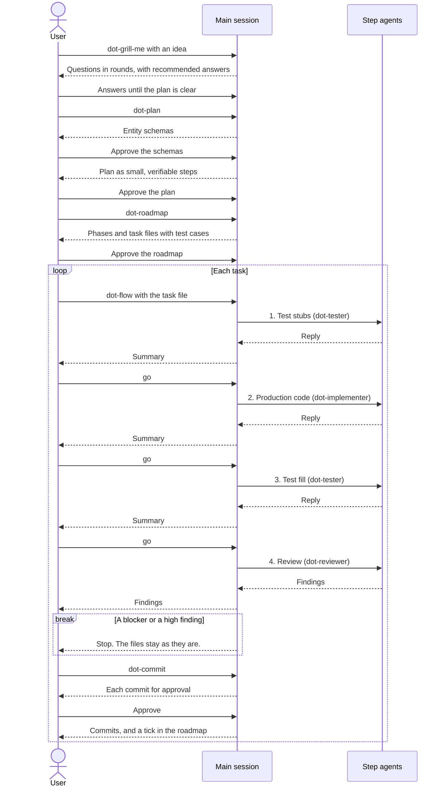

# dotagents

dotagents gives Claude Code, OpenAI Codex, and GitHub Copilot one AI workflow
for every project. The workflow plans a change, writes tests and code in small
steps, reviews the result, and asks for your approval between the steps.

dotagents has two parts:

- A plugin with skills, agents, and an end-of-turn hook. Claude Code, the
  Copilot CLI, and VS Code load the plugin.
- A CLI that installs the always-on rules for all three coding agents, and the
  skills for Codex and Copilot.

## Install

To install the plugin, run the following commands in Claude Code:

```text
/plugin marketplace add igorlau/dotagents
/plugin install dotagents@dotagents
```

The plugin skills have the `dotagents:` namespace, such as
`/dotagents:dot-plan`.

To install the rules for all your projects, and the skills for Codex and
Copilot, run the following command:

```bash
npx --yes @igorlau/dotagents install
```

The plugin hook runs the `check` script of a repository at the end of each
turn that changes files. The hook runs only in a repository that you enable.
To enable it, run the following command in the repository:

```bash
npx --yes @igorlau/dotagents check enable
```

`npx` runs dotagents without an install. To run `dotagents` as a command in
any terminal, install it globally:

```bash
npm install --global @igorlau/dotagents
```

To upgrade a global install, run
`npm install --global @igorlau/dotagents@latest`.

## Use dotagents in a repository

The global install covers every project, team repositories too, and writes
nothing to them.

To share the skills and rules with collaborators in a repository that you
own, run the following command in the repository, and commit the new files:

```bash
npx --yes @igorlau/dotagents init
```

## Start a new repository

To create starter agent instructions in a new repository, run the following
command in the repository:

```bash
npx --yes @igorlau/dotagents scaffold
```

The command creates the following files. It skips a file that exists, and it
never changes the files after that. The files belong to the repository, so
edit and commit them like any other file:

| File | Purpose |
| ---- | ------- |
| `AGENTS.md` | Project instructions for every agent: how to work, code and tests, security, and Git. |
| `CLAUDE.md` | Imports `AGENTS.md`, so Claude Code reads the same instructions. |
| `.claude/settings.json` | Blocks secret files from Claude Code, and asks before `git push`. |
| `.editorconfig`, `.gitattributes` | Keep whitespace and line endings the same in all editors and operating systems. |

Run `scaffold` before `init`. `init` adds a block to `AGENTS.md`, and
`scaffold` does not overwrite an `AGENTS.md` that exists.

## The flow

The following diagram shows the full flow, from an idea to the commits of one
task. The agent stops for your approval at each "approve" or "go":



`dot-flow` never commits. In Codex and Copilot, `dot-flow` runs the four steps
in the main session, with the same approvals.

To learn the workflow step by step, read the [guide](docs/guide/README.md).

## Commands

The following table gives a summary of the commands. For the options, run
`dotagents --help`.

| Command | Description |
| ------- | ----------- |
| `install` | Install globally. |
| `init` | Install into the current repository for collaborators. |
| `scaffold` | Create starter agent instructions in the current repository. |
| `update` | Apply the latest catalog to the installs. |
| `uninstall` | Remove everything that dotagents installed. |
| `doctor` | Find missing or changed files in the installs. |
| `list` | List the skills. |
| `self-update` | Run `update` with the latest release. |
| `check enable`, `check disable` | Start or stop the plugin `check` hook in the current repository. |

dotagents does not overwrite a file that you changed or that it did not
write. To overwrite the file, add `--force`.

## What is included

The always-on rules in [`plugin/rules/`](plugin/rules/) cover working
agreements, the smallest complete change from
[ponytail](https://github.com/DietrichGebert/ponytail), code comments, code
style, and writing.

The 15 skills in [`plugin/skills/`](plugin/skills/) load when a task needs
them:

| Skill | Purpose |
| ----- | ------- |
| `dot-grill-me` | Start an interview that makes a plan clear. |
| `dot-grilling` | Run the interview method of `dot-grill-me`. |
| `dot-plan` | Plan a change as small, verifiable steps, with entity schemas. |
| `dot-roadmap` | Split a plan into phases and tasks that each stand alone. |
| `dot-flow` | Take a roadmap task through test stubs, code, test fill, and review, with an approval after each step. |
| `dot-testing` | Write tests with a makeSut factory, as stubs before the code or in full after it. |
| `dot-implement` | Write the code of a change or roadmap task to the standards of the repository and the language. |
| `dot-code-review` | Review a diff for correctness bugs and maintainability problems. |
| `dot-comments` | Delete the comments in a diff that no exception protects. |
| `dot-commit` | Commit changes as small, logical commits. |
| `dot-debug` | Find the cause of a hard bug with a feedback loop. |
| `dot-correct` | Change a mistake that agents repeat into a check that prevents it. |
| `dot-handoff` | Give a summary of a conversation to another agent. |
| `dot-docs-writing` | Give docs the structure and format of the Google developer documentation style. |
| `dot-writing-for-agents` | Write skills, `AGENTS.md`, and `CLAUDE.md` files. |

The plugin also has 3 agents in [`plugin/agents/`](plugin/agents/).
`dot-flow` starts a new agent for each step, so each step starts with a clean
context:

| Agent | Purpose |
| ----- | ------- |
| `dot-tester` | Write the test stubs, or fill them after the code exists. |
| `dot-implementer` | Write the production code of a task. |
| `dot-reviewer` | Review the changes of a task. |

## More information

- [Design specification](SPEC.md)
- [Contributing guide](CONTRIBUTING.md): report problems and propose changes
  with pull requests
- [Third-party notices](THIRD_PARTY_NOTICES.md)
- [License (MIT)](LICENSE)
