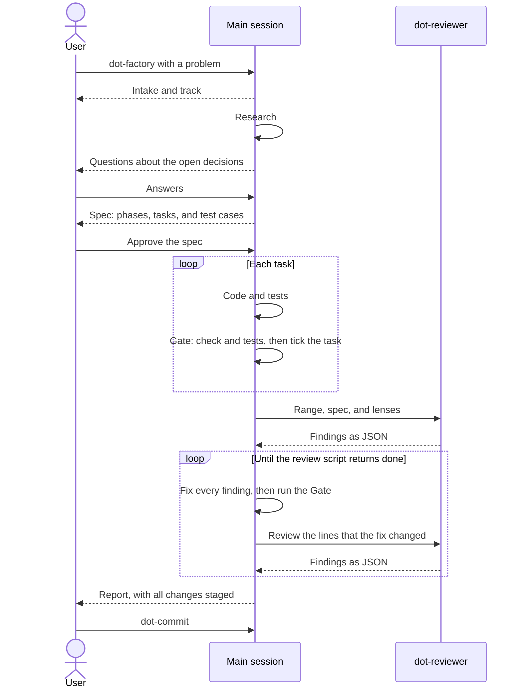

# dotagents

dotagents gives Claude Code and GitHub Copilot the same skills and rules
for every project. The skills plan a change, write code and tests in small
steps, verify each step, review the result, and ask for your decision. In
Claude Code, `dot-factory` runs these steps for you, from one description to
a staged change.

dotagents has two parts:

- A plugin with skills, agents, and hooks. Claude Code, the
  Copilot CLI, and VS Code load the plugin. `dot-factory` and the agents
  work only in Claude Code.
- A CLI that installs the always-on rules for both coding agents, and the
  skills for Copilot.

## Install

To install dotagents, run the following command in a terminal:

```bash
npx --yes @igorlau/dotagents
```

The wizard asks for your coding agents and where to install. For a global
install with Claude Code, it offers to install the Claude Code plugin. In a
repository, it can enable the `check` hook. It shows a summary and writes
nothing before you confirm.

The plugin skills have the `dotagents:` namespace, such as
`/dotagents:dot-plan`. The plugin hook runs the `check` script of a
repository at the end of each turn that changes files, only in a repository
that you enable.

For scripts and CI, use the commands with flags. Without a terminal, no
wizard opens. See [Install dotagents](docs/guide/01-install.md).

`npx` runs dotagents without an install. To run `dotagents` as a command in
any terminal, install it globally:

```bash
npm install --global @igorlau/dotagents
```

To upgrade a global install, run
`npm install --global @igorlau/dotagents@latest`.

## Use dotagents in a repository

The global install covers every project, team repositories too, and writes
nothing to them.

To share the skills and rules with collaborators in a repository that you
own, run the following command in the repository, and commit the new files:

```bash
npx --yes @igorlau/dotagents init
```

## Start a new repository

To create starter agent instructions in a new repository, run the following
command in the repository:

```bash
npx --yes @igorlau/dotagents scaffold
```

The command creates the following files. It skips a file that exists, and it
never changes the files after that. The files belong to the repository, so
edit and commit them like any other file:

| File | Purpose |
| ---- | ------- |
| `AGENTS.md` | Project instructions for every agent: how to work, code and tests, security, and Git. |
| `CLAUDE.md` | Imports `AGENTS.md`, so Claude Code reads the same instructions. |
| `.claude/settings.json` | Blocks secret files from Claude Code, and asks before `git push`. |
| `.editorconfig`, `.gitattributes` | Keep whitespace and line endings the same in all editors and operating systems. |

Run `scaffold` before `init`. `init` adds a block to `AGENTS.md`, and
`scaffold` does not overwrite an `AGENTS.md` that exists.

## The flow

In Claude Code, `dot-factory` takes a problem from one description to a
staged change. To start a run, give it the problem:

```text
/dotagents:dot-factory Export the invoices as CSV, and do not write a row twice when a retry starts.
```

The following diagram shows a run of the `feature` track. The main session
does all the work except the review, which runs in the `dot-reviewer` agent:



The run stops for you at the spec approval, at the report, and at each
escalation: a question that the rules of the run cannot answer. It never
commits. Start Claude Code with `claude --effort medium` for a run. The main
session does most of the work, and `dot-reviewer` has its own model and
effort.

Without `dot-factory`, and in Copilot, run each step yourself: `dot-grilling`,
`dot-plan`, and `dot-roadmap`, then `dot-implement`, `dot-testing`,
`dot-code-review`, and `dot-commit` for each task. To learn both ways, read
the [guide](docs/guide/README.md).

## Commands

The following table gives a summary of the commands. For the options, run
`dotagents --help`.

| Command | Description |
| ------- | ----------- |
| `install` | Install globally. |
| `init` | Install into the current repository for collaborators. |
| `scaffold` | Create starter agent instructions in the current repository. |
| `update` | Apply the latest catalog to the installs. |
| `uninstall` | Remove everything that dotagents installed. |
| `doctor` | Find missing or changed files in the installs. |
| `list` | List the skills. |
| `self-update` | Run `update` with the latest release. A CLI installed with `npm install -g` updates itself first. |
| `check enable`, `check disable` | Start or stop the plugin `check` hook in the current repository. |

dotagents does not overwrite a file that you changed or that it did not
write. To overwrite the file, add `--force`.

## What is included

The always-on rules in [`rules/`](rules/) cover working
agreements, the smallest complete change from
[ponytail](https://github.com/DietrichGebert/ponytail), code comments, code
style, and writing.

The 20 skills in [`skills/`](skills/) and
[`claude/skills/`](claude/skills/) load when a task needs them. You start
`dot-factory` yourself, and it works only in Claude Code:

| Skill | Purpose |
| ----- | ------- |
| `dot-factory` | Take a problem from one description to a staged change, with one spec approval and a Gate for each task. |
| `dot-grilling` | Run an interview, in rounds of questions, that makes a plan clear. |
| `dot-plan` | Plan a change as small, verifiable steps, with requirements and entity schemas. |
| `dot-roadmap` | Split a plan into phases and tasks that each stand alone. |
| `dot-testing` | Write tests with a makeSut factory, alone or after `dot-implement`. |
| `dot-implement` | Write the code of a change or roadmap task to the standards of the repository and the language. |
| `dot-code-review` | Review a diff for correctness bugs and maintainability problems. |
| `dot-walkthrough-branch` | Review the commits of a branch as an ordered stack of dependency layers. |
| `dot-walkthrough-changes` | Walk through the working-tree changes as an ordered stack of dependency layers. |
| `dot-security-audit` | Audit the whole codebase of a branch, or a path, for security vulnerabilities. |
| `dot-security-changes` | Check the working-tree changes for security problems. |
| `dot-ux-review` | Review UI code for UX and accessibility rules by reading the code, against the Vercel web interface guidelines. |
| `dot-ui-review` | Review UI changes visually in a browser against a live preview, or report why the review cannot run. |
| `dot-comments` | Delete the comments in a diff that no exception protects. |
| `dot-commit` | Commit changes as small, logical commits. |
| `dot-debug` | Find the cause of a hard bug with a feedback loop. |
| `dot-correct` | Change a mistake that agents repeat into a check that prevents it. |
| `dot-handoff` | Give a summary of a conversation to another agent. |
| `dot-docs-writing` | Give docs the structure and format of the Google developer documentation style. |
| `dot-writing-for-agents` | Write skills, `AGENTS.md`, and `CLAUDE.md` files. |

The plugin also has 3 agents in [`claude/agents/`](claude/agents/). Each
agent runs one step of a task in a clean context, with a fixed model and
effort. `dot-factory` starts only `dot-reviewer`:

| Agent | Purpose | Model | Effort |
| ----- | ------- | ----- | ------ |
| `dot-tester` | Write the tests of a task after the code exists. | `sonnet` | `medium` |
| `dot-implementer` | Write the production code of a task. | `sonnet` | `high` |
| `dot-reviewer` | Review a range of two trees, and write the findings as JSON. | `sonnet` | `high` |

## More information

- [Design specification](SPEC.md)
- [Contributing guide](CONTRIBUTING.md): report problems and propose changes
  with pull requests
- [Third-party notices](THIRD_PARTY_NOTICES.md)
- [License (MIT)](LICENSE)
