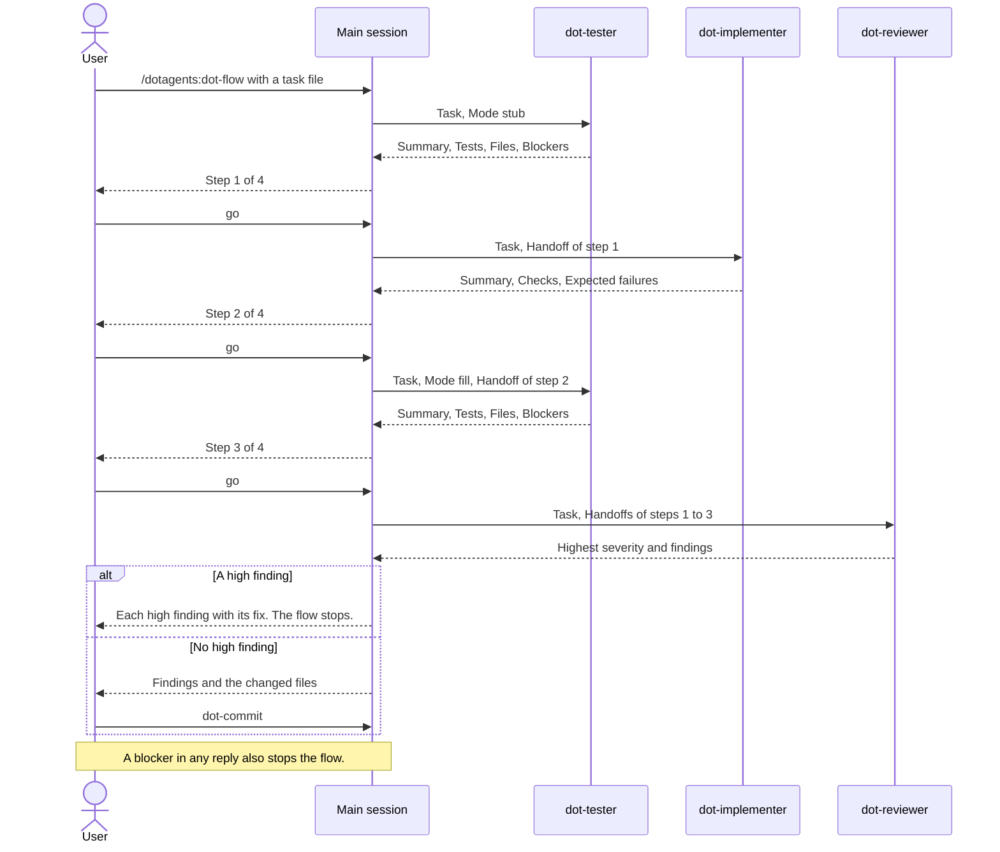

# Build a task

Build each roadmap task in three steps: test stubs, production code, then
test fill. The test names come from the task, so the tests check the
behavior that you approved, not the code that the agent wrote.

## Run a task with dot-flow

To run the steps and the review with an approval after each one, start
[`dot-flow`](../../plugin/skills/dot-flow/SKILL.md) with a task file or a
roadmap directory:

```text
/dotagents:dot-flow .tmp/roadmaps/invoice-export/01-core/01-csv-writer.md
```

With a roadmap directory, `dot-flow` picks the first unticked task whose
blockers are all ticked. Commit or put aside your other changes first,
because the review reads every uncommitted change.

The following diagram shows one task. Each step starts a new agent, so each
step starts with a clean context and one skill:



The agents are `dotagents:dot-tester`, `dotagents:dot-implementer`, and
`dotagents:dot-reviewer`. Each agent preloads one skill and receives the
always-on rules. No agent can start another agent.

After a stop, fix the problem, and ask for the same step again.

## Run the steps by hand

You can run each step yourself, in one conversation:

1. Start [`dot-testing`](../../plugin/skills/dot-testing/SKILL.md) in stub
   mode for the task. It writes each test case as a pending test, such as
   `it.todo`, and nothing else. The
   [modes reference](../../plugin/skills/dot-testing/references/modes.md)
   gives the details.
1. Start [`dot-implement`](../../plugin/skills/dot-implement/SKILL.md) for
   the task. It writes the production code and no tests. It runs the type
   checker, the linter, and the tests, and fixes each regression. It lists
   the expected failures: tests of behavior that the task changes on
   purpose.
1. Start `dot-testing` in fill mode. It changes each pending test into a
   real test, and changes the expected failures to the new behavior.

## Run a task in Codex and Copilot

Codex and Copilot do not start the dotagents agents, so `dot-flow` runs the
four steps in the main session, with the same approvals and stops:

```text
/dot-flow .tmp/roadmaps/invoice-export/01-core/01-csv-writer.md
```

The steps share one context, so the context grows with each step.

Next: [Review and commit](05-review-and-commit.md).
