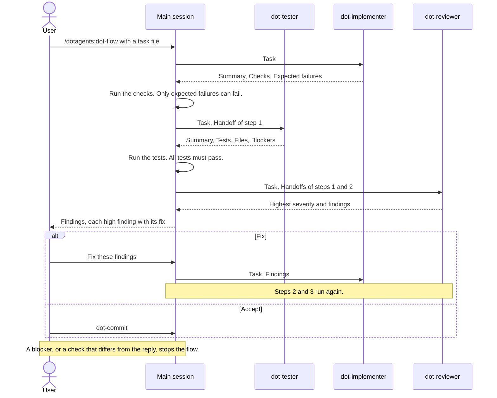

# Build a task

Build each roadmap task in three steps: production code, tests, then review.
The test names come from the task, so the tests check the behavior that you
approved, not the code that the agent wrote.

## Run a task with dot-flow

To run the steps, with a check of each result and one stop after the review, start
[`dot-flow`](../../plugin/skills/dot-flow/SKILL.md) with a task file or a
roadmap directory:

```text
/dotagents:dot-flow .tmp/roadmaps/invoice-export/01-core/01-csv-writer.md
```

With a roadmap directory, `dot-flow` picks the first unticked task whose
blockers are all ticked. Commit or put aside your other changes first,
because the review reads every uncommitted change.

The following diagram shows one task. Each step starts a new agent, so each
step starts with a clean context and one skill:



The agents are `dotagents:dot-tester`, `dotagents:dot-implementer`, and
`dotagents:dot-reviewer`. Each agent preloads one skill and receives the
always-on rules. No agent can start another agent.

`dot-flow` does not take the word of an agent. After the code and after the
tests, it runs the commands of the reply again, and stops when a result
differs.

After a stop, fix the problem, and ask for the same step again.

## Run the steps by hand

You can run each step yourself, in one conversation:

1. Start [`dot-implement`](../../plugin/skills/dot-implement/SKILL.md) for
   the task. It writes the production code. It runs the type checker, the
   linter, and the tests, and fixes each regression. It lists the expected
   failures: tests of behavior that the task changes on purpose.
1. `dot-implement` then starts
   [`dot-testing`](../../plugin/skills/dot-testing/SKILL.md) with that list.
   `dot-testing` writes each test case of the task as a test, and changes
   the expected failures to the new behavior. The
   [reference for tests after `dot-implement`](../../plugin/skills/dot-testing/references/after-implement.md)
   gives the details.
1. Start [`dot-code-review`](../../plugin/skills/dot-code-review/SKILL.md).

## Run a task in Codex and Copilot

Codex and Copilot do not start the dotagents agents, so `dot-flow` runs the
three steps in the main session, with the same verification and stops:

```text
/dot-flow .tmp/roadmaps/invoice-export/01-core/01-csv-writer.md
```

The steps share one context, so the context grows with each step.

Next: [Review and commit](05-review-and-commit.md).
